# Awesome Video Conferencing & Online Meetings 🎥 💻

  <strong>A curated directory of top Video Conferencing and Online Meeting platforms — featuring enterprise SaaS solutions, open-source WebRTC media servers, SFUs, and developer SDKs.</strong>

---

## 🧭 Table of Contents

- [📈 Sector Overview & Market Dynamics](#-sector-overview--market-dynamics)
- [🏢 SaaS / Hosted Platforms](#-saas--hosted-platforms)
- [💻 Open-Source Software](#-open-source-software)
- [📊 Feature Comparison Matrix](#-feature-comparison-matrix)
- [🤝 Contributing](#-contributing)
- [📄 License](#-license)

---

## 📈 Sector Overview & Market Dynamics

The global video conferencing market size was valued at **$10.6 billion in 2023** and is projected to surpass **$25.8 billion by 2030**, expanding at a Compound Annual Growth Rate (CAGR) of approximately **12.5%** driven by hybrid workplace architectures, remote education, and AI-assisted meeting summaries. 

The industry is **moderately concentrated** with high market consolidation at the enterprise general-collaboration tier (where hyperscalers and incumbents like Microsoft, Alphabet, Zoom, and Cisco command over 75% of commercial enterprise seats). However, it remains **highly fragmented and vibrant across vertical and developer segments**, where specialized self-hosted WebRTC engines, HIPAA-compliant telehealth portals, education-first classrooms, and privacy-focused open-source SFUs thrive independently of big-tech dominance.

---

## 🏢 SaaS / Hosted Platforms

Below is an overview of leading cloud-hosted commercial meeting platforms, sorted in descending order by company scale (valuation / market capitalization / annual enterprise revenue):

| Platform | Company Valuation / Revenue Scale | Starting Paid Tier Pricing | Free Tier / Trial Limit | Key Highlights |
| :--- | :--- | :--- | :--- | :--- |
| **[Microsoft Teams](https://www.microsoft.com/en-us/microsoft-teams/)** 💼 | **~$3.1 Trillion** market cap (Microsoft Corp / ~$245B annual revenue) | **$4.00 / user / month** (Microsoft Teams Essentials, annual commitment) | **Free forever plan**: up to 100 participants, 60 minutes group meeting limit, 5 GB cloud storage per user | Integrated workspace hub embedded into Microsoft 365 with whiteboard, live captions, and breakout rooms. |
| **[Google Meet](https://meet.google.com/)** 🌐 | **~$2.1 Trillion** market cap (Alphabet Inc / ~$307B annual revenue) | **$7.00 / user / month** (Google Workspace Business Starter, annual commitment) | **Free forever plan**: up to 100 participants, 60 minutes group meeting limit (24 hours for 1:1 calls), 15 GB Google Drive storage | Browser-first zero-install video conferencing deeply connected with Google Calendar, Gmail, and Docs. |
| **[Cisco Webex](https://www.webex.com/)** 🛡️ | **~$230 Billion** market cap (Cisco Systems / ~$54B annual revenue) | **$12.00 / license / month** (Webex Meet plan, paid annually or $14.50/mo billed monthly) | **Free forever plan**: up to 100 participants, 40 minutes per meeting, local recording, breakout sessions | Enterprise-grade security, noise removal, end-to-end encryption, and hardware room ecosystem integration. |
| **[Zoom Workplace](https://zoom.us/)** 📹 | **~$22 Billion** market cap (Zoom Video Communications / ~$4.5B annual revenue) | **$13.33 / user / month** (Zoom Workplace Pro, billed annually at $159.90/yr or $15.99/mo) | **Free forever plan (Basic)**: up to 100 participants, 40 minutes per group meeting, 3 editable whiteboards | Gold-standard meeting reliability, virtual background engine, AI Companion, and massive third-party app ecosystem. |
| **[RingCentral Video](https://www.ringcentral.com/)** 📞 | **~$3.2 Billion** market cap (RingCentral Inc / ~$2.2B annual revenue) | **$20.00 / user / month** (RingCentral Core, annual billing or $30/mo billed monthly) | **Free forever plan (RingCentral Video Pro)**: up to 100 participants, 50 minutes meeting limit, 24-hour recording cloud retention | Unified communications suite merging cloud PBX telephony, team chat, SMS, and video meetings. |
| **[GoToMeeting](https://www.goto.com/meeting)** 🤝 | **~$2.5 Billion** valuation (GoTo / LogMeIn private equity valuation) | **$12.00 / organizer / month** (GoTo Meeting Professional, billed annually at $144/yr or $14/mo) | **14-day free trial**: fully functional access supporting up to 250 participants; no permanent free plan | Classic business meeting platform featuring drawing tools, commuter mode, keyboard/mouse sharing, and toll-free dial-in. |
| **[Whereby](https://whereby.com/)** 🚪 | **~$200 Million** valuation (Venture-backed: Point Nine, Creandum / ~$20M+ funding) | **$8.99 / user / month** (Whereby Pro, billed annually or $11.99/mo billed monthly) | **Free forever plan**: 1 permanent room URL, up to 100 participants, 45 minutes group meeting limit | Frictionless instant browser meetings with custom branded URLs without guest downloads or login requirements. |

---

## 💻 Open-Source Software

Self-hostable, community-driven video conferencing software and WebRTC infrastructure. All listed repositories are genuinely open-source and sorted in descending order by GitHub stargazers count:

### 1. [Jitsi Meet](https://github.com/jitsi/jitsi-meet) 🌟
  
- **Tech Stack:** Java, JavaScript, React, WebRTC 🛠️
- **License:** Apache-2.0 📜
- **Overview:** The undisputed gold standard of open-source video meetings. Provides frictionless 1-click meeting links in any browser with zero client downloads. Features include HD audio/video, screen sharing, lobby security mode, end-to-end encryption (E2EE), chat, and recording capabilities via Jibri.
- **Best For:** Self-hosted enterprise and community Zoom replacements prioritizing data sovereignty.

### 2. [LiveKit](https://github.com/livekit/livekit) ⚡
  
- **Tech Stack:** Go, WebRTC, Rust, TypeScript 🛠️
- **License:** Apache-2.0 📜
- **Overview:** Modern, ultra-scalable WebRTC infrastructure and SFU designed to power interactive video, audio, and multimodal AI voice agents. Offers multi-platform client SDKs (Web, iOS, Android, Flutter, React Native, Unity) and ecosystem modules for recording (Egress) and streaming (Ingress).
- **Best For:** Developers architecting real-time video conferencing, AI audio agents, or telehealth apps.

### 3. [BigBlueButton](https://github.com/bigbluebutton/bigbluebutton) 🎓
  
- **Tech Stack:** Java, JavaScript, Scala, WebRTC 🛠️
- **License:** LGPL-3.0 📜
- **Overview:** Purpose-built virtual classroom and webinar system engineered specifically for online learning. Deeply integrates multi-user whiteboards, presentation slide uploads with server-side vectorization, timed breakout rooms, live emoji polling, and LMS integrations (Moodle, Canvas, Blackboard).
- **Best For:** Schools, universities, academic institutions, and corporate training academies.

### 4. [Janus WebRTC Server](https://github.com/meetecho/janus-gateway) 🔌
  
- **Tech Stack:** C, WebRTC 🛠️
- **License:** GPL-3.0 📜
- **Overview:** A battle-tested general-purpose WebRTC server by Meetecho designed as a lightweight C core that delegates meeting routing, SIP gateways, audio bridges, and video rooms to a versatile C plugin architecture.
- **Best For:** High-throughput media routing, telecommunications bridging, and custom WebRTC streaming.

### 5. [mediasoup](https://github.com/versatica/mediasoup) 🚀
  
- **Tech Stack:** C++, TypeScript, Node.js, Rust 🛠️
- **License:** ISC 📜
- **Overview:** Cutting-edge, low-level Selective Forwarding Unit (SFU) library that runs as a Node.js/Rust worker with high-performance C++ media threads. Enables fine-grained piping of RTP audio/video streams with minimal memory overhead.
- **Best For:** Engineering custom, high-concurrency multi-party video conferencing architectures.

### 6. [MiroTalk](https://github.com/miroslavpejic85/mirotalk) 💬
  
- **Tech Stack:** JavaScript, Node.js, WebRTC 🛠️
- **License:** AGPL-3.0 📜
- **Overview:** A sleek, fully featured suite of real-time video conferencing variants including MiroTalk P2P (mesh calls up to 4K 60fps), MiroTalk SFU (mediasoup-based scalable rooms), and MiroTalk C2C (instant embeddable iframe cam-to-cam widgets).
- **Best For:** Teams wanting lightweight, clean, and easily embeddable self-hosted video meeting rooms.

### 7. [Ant Media Server](https://github.com/ant-media/Ant-Media-Server) 📡
  
- **Tech Stack:** Java, C++, WebRTC 🛠️
- **License:** Apache-2.0 (Community Edition) 📜
- **Overview:** Ultra-low latency streaming and interactive video engine (~0.5s latency) supporting WebRTC, CMAF, HLS, RTMP, and RTSP with adaptive bitrate streaming, video recording, and auto-scaling support.
- **Best For:** Interactive live broadcasts, large-scale webinars, and ultra-low-latency interactive conferences.

### 8. [OpenVidu](https://github.com/OpenVidu/openvidu) 🧩
  
- **Tech Stack:** TypeScript, Java, Go, WebRTC 🛠️
- **License:** Apache-2.0 📜
- **Overview:** A complete developer platform for integrating high-quality video calling into web and mobile apps. OpenVidu v3 builds on modern media engines to deliver seamless multi-party rooms, screen sharing, recording, and moderation APIs.
- **Best For:** Developers desiring a simple, developer-friendly abstraction layer over raw WebRTC infrastructure.

### 9. [Galène](https://github.com/jech/galene) 🍃
  
- **Tech Stack:** Go 🛠️
- **License:** MIT 📜
- **Overview:** Ultra-lightweight SFU server developed at Université de Paris engineered for extreme CPU efficiency. Capable of handling over 100 concurrent student video streams on just a 0.25 vCPU core without transcoding.
- **Best For:** Homelab hosts, low-resource VPS environments, and schools running lectures on budget hardware.

### 10. [EduMeet](https://github.com/edumeet/edumeet) 🧑‍🏫
  
- **Tech Stack:** Node.js, TypeScript, React, mediasoup 🛠️
- **License:** MIT 📜
- **Overview:** An open-source, web-based multiparticipant videoconferencing solution developed within European research networks (GÉANT). Features shared whiteboards, file sharing, breakout rooms, and federated institutional authentication.
- **Best For:** Academic consortia, research organizations, and open education initiatives.

### 11. [Element Call](https://github.com/element-hq/element-call) 🔒
  
- **Tech Stack:** TypeScript, React, Matrix WebRTC SFU 🛠️
- **License:** AGPL-3.0 📜
- **Overview:** Next-generation decentralized, native WebRTC calling powered entirely by the Matrix protocol. Features end-to-end encryption for multi-party group calls, eliminating centralized proprietary telephony silos.
- **Best For:** Privacy-first organizations and decentralized Matrix chat/collaboration networks.

### 12. [Apache OpenMeetings](https://github.com/apache/openmeetings) 🏛️
  
- **Tech Stack:** Java, Wicket, WebRTC 🛠️
- **License:** Apache-2.0 📜
- **Overview:** A veteran Apache foundation project providing full groupware collaboration, virtual meeting rooms, multi-whiteboard workspaces, document sharing/editing, user management, and fine-grained room moderation.
- **Best For:** Enterprise setups requiring Apache governance and collaborative document presentation.

### 13. [plugNmeet](https://github.com/mynaparrot/plugNmeet-server) 🔌
  
- **Tech Stack:** Go, React, TypeScript, LiveKit 🛠️
- **License:** MIT 📜
- **Overview:** A customizable, high-performance web conferencing system built on Go and LiveKit. Features whiteboard drawing, breakout rooms, live polling, RTMP streaming to YouTube/Facebook, and integrated AI meeting translation and summarization.
- **Best For:** Teams wanting an MIT-licensed, plug-and-play webinar platform with modern breakout rooms and AI capabilities.

---

## 📊 Feature Comparison Matrix

| Platform / Software | Type / License | Breakout Rooms 🚪 | E2EE Support 🔐 | Self-Hostable 🖥️ | Ideal Use Case 🎯 |
| :--- | :--- | :---: | :---: | :---: | :--- |
| **Microsoft Teams** | SaaS (Commercial) | ✅ Yes | ✅ Supported | ❌ Cloud Only | Enterprise Microsoft 365 organizations |
| **Google Meet** | SaaS (Commercial) | ✅ Yes | ✅ Supported | ❌ Cloud Only | Google Workspace teams & quick browser meetings |
| **Cisco Webex** | SaaS (Commercial) | ✅ Yes | ✅ Supported | ❌ Cloud Only | Enterprise compliance, hardware rooms & Cisco networks |
| **Zoom Workplace** | SaaS (Commercial) | ✅ Yes | ✅ Supported | ❌ Cloud Only | General business conferencing & webinars |
| **RingCentral Video** | SaaS (Commercial) | ✅ Yes | ✅ Supported | ❌ Cloud Only | Companies unifying cloud telephony and video calls |
| **GoToMeeting** | SaaS (Commercial) | ✅ Yes | ❌ Basic TLS | ❌ Cloud Only | Traditional corporate presentations & dial-in meetings |
| **Whereby** | SaaS (Commercial) | ❌ No | ❌ Basic TLS | ❌ Cloud Only | Frictionless client booking & branded web rooms |
| **Jitsi Meet** | Open-Source (Apache-2.0) | ✅ (Via Jibri) | ✅ Supported | ✅ Yes | Turnkey open-source Zoom replacement |
| **LiveKit** | Open-Source (Apache-2.0) | ✅ (Via SDK) | ✅ Supported | ✅ Yes | Programmable WebRTC video/voice infrastructure |
| **BigBlueButton** | Open-Source (LGPL-3.0) | ✅ Built-in | ❌ No | ✅ Yes | Online schooling, virtual lectures & university classes |
| **Janus Gateway** | Open-Source (GPL-3.0) | 🔌 (Plugin) | ✅ Supported | ✅ Yes | Modular WebRTC server & telecom SIP gateway |
| **mediasoup** | Open-Source (ISC) | 🔌 (Custom) | ✅ Supported | ✅ Yes | High-performance custom SFU streaming backends |
| **MiroTalk** | Open-Source (AGPL-3.0) | ❌ No | ✅ (P2P mode) | ✅ Yes | Zero-config embeddable WebRTC rooms |
| **Ant Media Server** | Open-Source (Apache-2.0) | 🔌 (Custom) | ✅ Supported | ✅ Yes | Ultra-low latency streaming & RTMP re-broadcasting |
| **OpenVidu** | Open-Source (Apache-2.0) | ✅ Yes | ✅ Supported | ✅ Yes | Developer-friendly WebRTC integration for apps |
| **Galène** | Open-Source (MIT) | ❌ No | ❌ No | ✅ Yes | Extreme CPU/RAM efficiency on low-spec servers |
| **EduMeet** | Open-Source (MIT) | ✅ Yes | ❌ TLS-only | ✅ Yes | Higher education and research institute collaboration |
| **Element Call** | Open-Source (AGPL-3.0) | ❌ No | ✅ Native E2EE | ✅ Yes | Decentralized Matrix-native secure calls |
| **OpenMeetings** | Open-Source (Apache-2.0) | ❌ No | ❌ TLS-only | ✅ Yes | Apache-backed document sharing and meetings |
| **plugNmeet** | Open-Source (MIT) | ✅ Built-in | ✅ Supported | ✅ Yes | Interactive webinars with AI transcription |

---

## 🤝 Contributing

Contributions, recommendations, and corrections are warmly welcome! 💖

If you would like to submit a new open-source platform, WebRTC library, or hosted tool:
1. Fork this repository 🍴
2. Create your branch (`git checkout -b feature/new-tool`) 🌿
3. Add your entry following the established formatting guidelines 📝
4. Commit your changes (`git commit -m "Add <Tool-Name>"`) 🚀
5. Push to your branch and open a Pull Request ✨

Please make sure open-source submissions are actively maintained with genuine open-source licensing.

---

## 📄 License

This repository and curated list are released under the [Creative Commons Zero v1.0 Universal](LICENSE) (CC0 1.0 - Public Domain Dedication).  
Software brands, logos, and third-party projects remain under the copyright and licenses of their respective creators.

---

  ⭐ Found this list helpful? Please star this repository to help others discover it! ⭐

